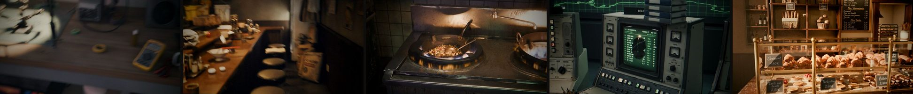
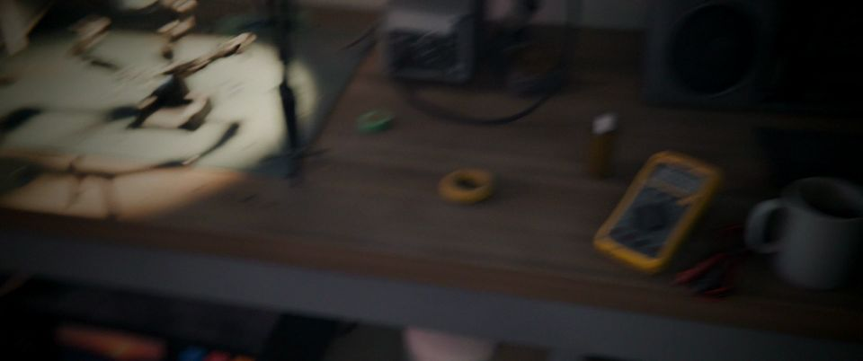
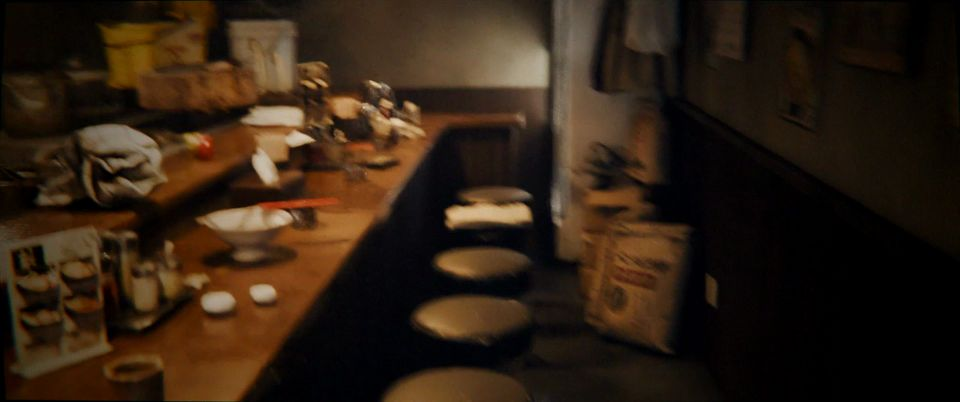
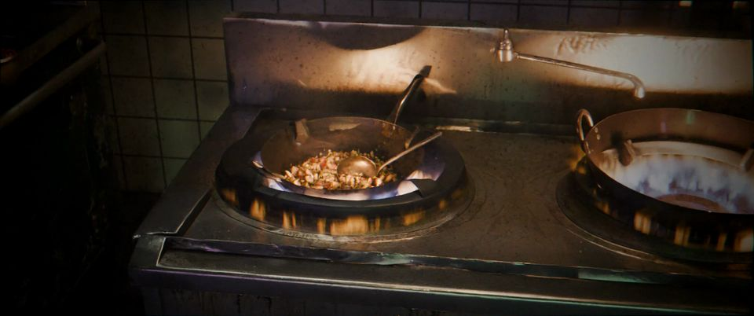
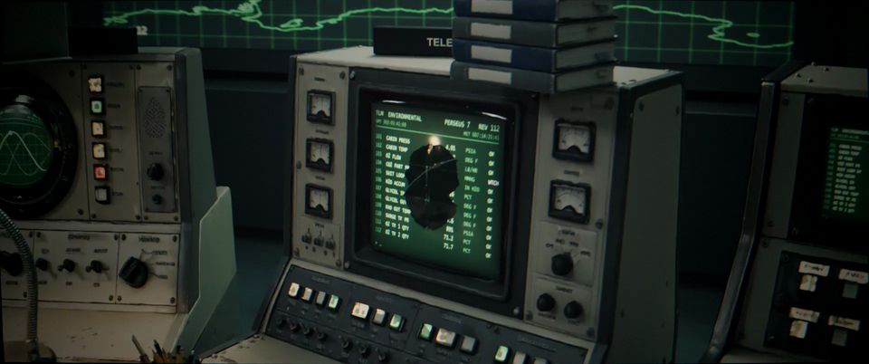
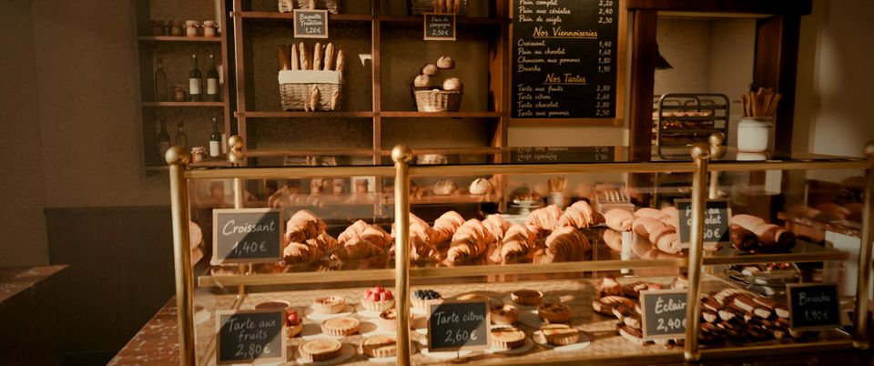

# AnyScene

Give it reference images of a place (or a one-paragraph brief) and it builds a dressed, lit Blender scene: a real room
with every prop as its own model, practical lights, grime, haze, cinematic camera moves and graded renders.

The work is done by an AI agent (Claude, in Claude Code) following [`SKILL.md`](SKILL.md). No prop is modelled by hand:
each one is generated as an image, turned into 3D with two image-to-3D models on [fal](https://fal.ai), and the better
result is picked by comparing same-light renders.



## Five places, one process

| | Scene | |
|---|---|---|
|  | **Electronics repair shop**, Tokyo, 1 AM, rain outside | [`scenes/tokyo-electronics-repair`](scenes/tokyo-electronics-repair) · 86 generated props |
|  | **Ramen shop**, Tokyo, last orders, steam and rain | [`scenes/tokyo-ramen-shop`](scenes/tokyo-ramen-shop) · 74 generated props |
|  | **Dai pai dong**, Hong Kong, an open-air street kitchen just after rain | [`scenes/hk-dai-pai-dong`](scenes/hk-dai-pai-dong) · 78 generated props |
|  | **Mission control**, 1970s, a night shift during an orbital flight | [`scenes/mission-control-1970s`](scenes/mission-control-1970s) |
|  | **Maison Roussel**, a Paris bakery. Built by the hosted endpoint from [one reference image](docs/media/bakery_reference.jpg), with no human input, in under two hours | (endpoint run) |

The first four were built by an agent working through `SKILL.md`, with a person checking its gates. The bakery was built
end to end by the same process running unattended on a fal GPU worker.

This repo is the process and the code. The finished scenes (.blend files, generated models, textures, renders) add up
to tens of gigabytes and are not in git. Each scene folder keeps what's needed to rebuild it: its prop list
(`assets.json`), model picks with reasons (`picks.json`), shots (`shots.json`), notes and build scripts.

## Quick start

You need:
- [Blender](https://www.blender.org/) 5.0 or newer. Set `BLENDER` if it isn't on your PATH or in the default install location.
- [Node](https://nodejs.org/) 20 or newer, then `npm install` in the repo root.
- A [fal API key](https://fal.ai/dashboard/keys) in `FAL_KEY`. Generation is billed to your fal account: roughly $1.65
  per prop (an image plus two 3D models), so about $150 for a 90-prop scene.
- ffmpeg with an H.264 encoder (`FFMPEG`, default `ffmpeg`). The example scenes were built on Windows with an NVIDIA GPU
  and use `h264_nvenc`; on other machines, swap in `libx264`.
- [uv](https://docs.astral.sh/uv/) for the Python helper scripts.
- [Claude Code](https://claude.com/claude-code).
- A GPU with 12–16 GB of memory for Cycles.

Then open the repo in Claude Code and ask for a scene:

> Use SKILL.md to build a new scene: a Lisbon tram depot at dawn, one tram half-stripped for repair.

Or start from your own references: put a few images (and, optionally, a floor plan) in `refs/<scene>/` and say so:

> Use SKILL.md to build a scene from the reference images in refs/lisbon-tram-depot/. Treat them as the approved concept.

Check the agent's work at each gate: concept, prop picks, clay layout, lit stills, shot previews. Expect most of a day
of agent time and 1–2 GPU-hours of final renders per scene.

## How the agent works

[`SKILL.md`](SKILL.md) is the whole process, step by step, with every gotcha the example scenes hit:

1. brief → scene spec (room size, zones, hero spots, real light sources);
2. concept images, or your references;
3. a prop manifest, then a reference image for every prop;
4. each prop through both Tripo H3.1 and Meshy 7.1, picked by looking at same-light renders;
5. a scripted room shell, dressing from big furniture down to small clutter, with collision and floating checks;
6. grime, de-branding, decals, practical lighting, haze, steam and rain;
7. cinematic and long handheld walkthrough shots, rendered in Cycles and graded;
8. optionally, a behind-the-scenes video.

Every step ends with a gate: a contact sheet the agent has to look at before moving on. Everything is a script, so the
.blend is a build output that can be regenerated.

[`builder/CRAFT.md`](builder/CRAFT.md) is the short version of what made the good scenes good: render it and look, name
the problem precisely, fix it in code, check the fix from a view that shows it, and get an independent critic.

## Layout

```
SKILL.md          the process; agents start here
builder/CRAFT.md  the review loop that separates good scenes from first drafts
generate/         fal client: images and image→3D (Tripo H3.1, Meshy 7.1), with a local spend log
pipeline/         Blender/ffmpeg discovery, a FIFO GPU queue, comparison renders, gallery pages, floating-prop check
camera/           camera rig and shot renderer: moves, rack focus, handheld walk, lens effects (synced from AnyShot)
breakdown/        behind-the-scenes videos, promo cuts and the launch supercut
scenes/<name>/    one folder per scene: assets.json, picks.json, shots.json, NOTES.md, brief.md, scripts/
farm/             a fal Serverless render farm for Cycles (app.py, synced from AnyShot), and a client that renders a scene's shots on it
blender_addon/    the fal Render Farm add-on for Blender
builder/          the same process packaged as a fal Serverless app (the hosted endpoint)
docs/             endpoint and API notes, README images
scripts/          sync_from_anyshot.py: refresh the files shared with AnyShot from a sibling ../anyshot checkout
```

## Hosted endpoint (optional)

If you'd rather not set up Blender, a GPU and the toolchain, the hosted endpoint runs the whole build on fal: send one
to four reference images (and an optional prompt), and get back the scene package (`scene.blend` with every prop as
its own object, a `scene.glb`, stills and panoramas; walkthroughs render on the farm). The bakery above was built this way, from a single image.

<!-- TODO(apek): link the public endpoint page / model id here once it's listed. -->

The endpoint's code is in [`builder/`](builder) if you want to deploy your own copy to your fal account
(`fal deploy builder/app.py::SceneBuilderApp --app-name anyscene-builder`). It needs `FAL_KEY` and `OPENROUTER_API_KEY` set
as secrets on the app, and the `endpoint/` folder alongside it (the builder imports its planner and schema).

## Shooting builds: AnyShot

Stills and camera moves of a finished build are made by [AnyShot](https://github.com/apekshik/anyshot), an AI
cinematographer that lives in its own repo and runs as its own fal app. Deploy it on the same fal account and set
`fal secrets set ANYSHOT_APP=<your-fal-username>/anyshot`: the builder's `/scene2image`, `/scene2video` and `/shots`
routes (and the optional `shots` order on `/ref2scene`) forward to it over the fal API and relay its live log, and
AnyShot reads the build straight from the account's `/data` storage by `build_id`. AnyShot also takes any uploaded
`.blend`, so you can call it directly.

The code both repos use (`camera/`, `builder/blender_gpu.py`, `farm/app.py`, `pipeline/env.sh`, `pipeline/gpu_run.sh`)
lives in AnyShot; the copies here carry a "synced from" header. Edit them there, then run
`python scripts/sync_from_anyshot.py` with AnyShot checked out next to this repo.

## Render farm add-on

[`blender_addon/`](blender_addon) is a Blender add-on that renders the open scene on fal GPUs instead of your own:
direct a scene in Blender, press **Render animation on fal**, and the frames come back into the scene's output path
with the same names a local render would give them. See [`blender_addon/README.md`](blender_addon/README.md) for
install and settings. The farm itself is [`farm/app.py`](farm/app.py) (its home is AnyShot's `farm/app.py`); you can deploy your own and point the add-on's
**Farm app** preference at it.

## Licence

Code is MIT, see [LICENSE](LICENSE). Generated assets are not in this repo; where they're published, they come with
their own licence.
